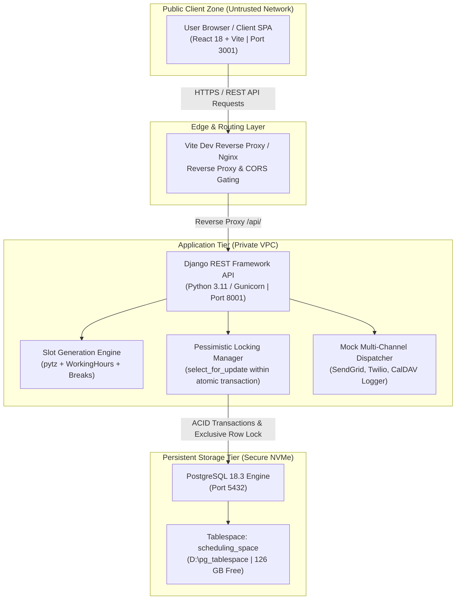

# Falcon Calendar — System Architecture & Topology Specification
**Deliverable 02 | FalconXoft 15-Day Intern Performance Evaluation | Project 2**

---

## 1. Lucidchart Workspace Reference
> **Lucidchart Editable Diagram URL:**  
> [https://lucid.app/lucidchart/6cc67ccc-6a0e-427e-9ddb-374ea653b18c/edit?viewport_loc=238%2C535%2C1907%2C925%2C0_0&invitationId=inv_81aa2c24-8f92-4c07-bea2-d8a396ebd693](https://lucid.app/lucidchart/6cc67ccc-6a0e-427e-9ddb-374ea653b18c/edit?viewport_loc=238%2C535%2C1907%2C925%2C0_0&invitationId=inv_81aa2c24-8f92-4c07-bea2-d8a396ebd693)  
> *Note: Full editor and commenter permissions are granted for architectural evaluation.*  
> **Exported Deliverable Files:** [`02 - architecture.pdf`](./02%20-%20architecture.pdf)

---

## 2. High-Level Architecture & Deployment Boundaries

---

## 3. Component Details & Responsibilities

| Component | Technology | Primary Responsibilities | Deployment Boundary |
| :--- | :--- | :--- | :--- |
| **Frontend SPA** | React 18.3, Vanilla CSS, Vite | Client timezone resolution, dynamic slot presentation, interactive booking modal, client self-service portal | Public browser / CDN |
| **Reverse Proxy** | Vite Proxy / Nginx | Path-based routing, CORS header injection, payload size validation | Edge Perimeter |
| **Backend REST API** | Django 5.0, DRF 3.15 | Business logic, authentication, input sanitization, error wrapping, OpenAPI spec generation | Private Application Pod |
| **Slot Generator Engine** | Python `pytz` & `datetime` | Provider working hours bounds evaluation, holiday override exclusion, break period filtering, candidate interval projection | Internal Module |
| **Concurrency Defense** | PostgreSQL `SELECT ... FOR UPDATE` | Serializes booking requests at the provider row level; guarantees zero overlapping active slots | Database Transaction Engine |
| **Database Tablespace** | PostgreSQL 18 Tablespace | Stores all relational tables and B-tree/GiST indexes on high-capacity NVMe drive (`D:\pg_tablespace`) | Secure Storage Volume |
| **Notification Gateway** | Mock Multi-Channel Dispatcher | Dispatches simulated booking confirmation emails, SMS text alerts, and calendar ICS invites with immutable audit logging | Internal Service |

---

## 4. Concurrency Defense & Double-Booking Prevention Flow

When multiple clients attempt to book the same or overlapping time slots simultaneously, the system executes the following deterministic defense sequence:

```mermaid
sequenceDiagram
    autonumber
    actor ClientA as Client A (Browser)
    actor ClientB as Client B (Browser)
    participant API as DRF Application Server
    participant DB as PostgreSQL 18 (scheduling_saas_db)

    ClientA->>API: POST /api/appointments/book/ (Slot: 10:00 - 10:30 UTC)
    ClientB->>API: POST /api/appointments/book/ (Slot: 10:00 - 10:30 UTC)
    
    rect rgb(20, 30, 50)
        Note over API,DB: Transaction Atomic Block A
        API->>DB: BEGIN TRANSACTION A
        API->>DB: SELECT * FROM ProviderProfile WHERE id=P1 FOR UPDATE
        Note over DB: Lock Acquired by Transaction A
    end

    rect rgb(40, 20, 20)
        Note over API,DB: Transaction Atomic Block B
        API->>DB: BEGIN TRANSACTION B
        API->>DB: SELECT * FROM ProviderProfile WHERE id=P1 FOR UPDATE
        Note over DB: Transaction B BLOCKS waiting for Lock on P1
    end

    API->>DB: Check Overlaps for 10:00 - 10:30 with 15m Buffer
    DB-->>API: 0 Existing Overlaps Found
    API->>DB: INSERT INTO scheduling_appointment (status='CONFIRMED', ...)
    API->>DB: COMMIT TRANSACTION A
    Note over DB: Lock on P1 RELEASED. Transaction B Unblocks!

    DB-->>API: Transaction A Succeeded
    API-->>ClientA: HTTP 201 Created (Booking Confirmed, Meeting Link Generated)

    Note over API,DB: Transaction B resumes execution
    API->>DB: Check Overlaps for 10:00 - 10:30 with 15m Buffer
    DB-->>API: 1 Conflicting Active Appointment Found (Client A)
    API->>DB: ROLLBACK TRANSACTION B
    API-->>ClientB: HTTP 409 Conflict (DOUBLE_BOOKING_PREVENTED)
```

---

## 5. Trust Boundaries & Security Architecture
1. **Network Boundary:** The database (`5432`) is bound strictly to `localhost` and is inaccessible from external networks.
2. **Input Validation:** All dates and times are validated against strict ISO-8601 specifications. Negative timestamps or times in the past are rejected with HTTP 400 Bad Request.
3. **Optimistic & Pessimistic Hybrid Concurrency:** 
   - Pessimistic row locking (`select_for_update`) prevents simultaneous booking collisions.
   - Version fields (`version = version + 1`) ensure that concurrent updates or admin cancellations detect stale state.
4. **Data Privacy:** Customer emails, phone numbers, and consultation notes are strictly scoped and indexed only for authorized retrieval.
