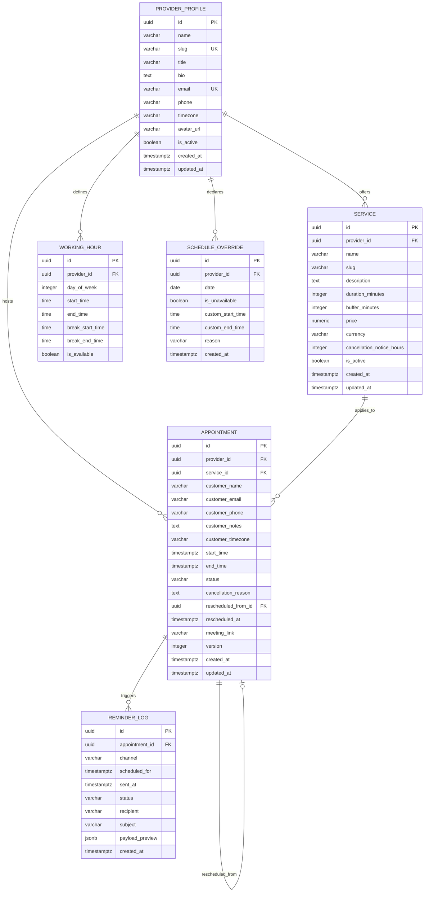

# Falcon Calendar — Database Design & Schema Specification
**Deliverable 03 | FalconXoft 15-Day Intern Performance Evaluation | Project 2**

---

## 1. Lucidchart Workspace Reference
> **Lucidchart Editable ERD Diagram URL:**  
> [https://lucid.app/lucidchart/c06c4f0a-9b57-45b8-afa7-2f1330eef03f/edit?viewport_loc=-12%2C1253%2C2584%2C1253%2C0_0&invitationId=inv_bf6f93f4-00fd-4e57-a5c9-07e5191f5891](https://lucid.app/lucidchart/c06c4f0a-9b57-45b8-afa7-2f1330eef03f/edit?viewport_loc=-12%2C1253%2C2584%2C1253%2C0_0&invitationId=inv_bf6f93f4-00fd-4e57-a5c9-07e5191f5891)  
> *Note: Full editor and commenter permissions are granted for database schema review.*  
> **Exported Deliverable Files:** [`03 - database-design.png`](./03%20-%20database-design.png) | [`03 - database-design.pdf`](./03%20-%20database-design.pdf) | [`03 - schema.sql`](./03%20-%20schema.sql)

---

## 2. Entity-Relationship Diagram (ERD)



---

## 3. Storage Architecture: Dedicated Tablespace on Drive D
To eliminate storage constraints on the system drive (`C:\`), the PostgreSQL database cluster was configured with a dedicated high-capacity tablespace:
```sql
CREATE TABLESPACE scheduling_space LOCATION 'D:/pg_tablespace';
CREATE DATABASE scheduling_saas_db TABLESPACE scheduling_space;
```
This isolates the scheduling database on NVMe storage with over 126 GB of available space, ensuring zero IO bottleneck during concurrent lock acquisitions.

---

## 4. Detailed Data Dictionary

### Table: `scheduling_providerprofile`
| Column | Type | Nullable | Constraints & Defaults | Description |
| :--- | :--- | :--- | :--- | :--- |
| `id` | UUID | No | PRIMARY KEY, `uuid_generate_v4()` | Unique identifier |
| `name` | VARCHAR(150) | No | None | Consultant full name |
| `slug` | VARCHAR(150) | No | UNIQUE | URL-safe identifier |
| `title` | VARCHAR(200) | No | None | Professional designation |
| `bio` | TEXT | No | DEFAULT `''` | Background narrative |
| `email` | VARCHAR(254) | No | UNIQUE | Consultant email address |
| `phone` | VARCHAR(30) | No | DEFAULT `''` | Direct contact number |
| `timezone` | VARCHAR(50) | No | DEFAULT `'UTC'` | Canonical IANA timezone string |
| `avatar_url` | VARCHAR(200) | No | DEFAULT `''` | Profile image URL |
| `is_active` | BOOLEAN | No | DEFAULT `TRUE` | Soft-deletion flag |
| `created_at` | TIMESTAMPTZ | No | DEFAULT `CURRENT_TIMESTAMP` | Audit creation timestamp |
| `updated_at` | TIMESTAMPTZ | No | DEFAULT `CURRENT_TIMESTAMP` | Last updated timestamp |

### Table: `scheduling_service`
| Column | Type | Nullable | Constraints & Defaults | Description |
| :--- | :--- | :--- | :--- | :--- |
| `id` | UUID | No | PRIMARY KEY | Unique identifier |
| `provider_id` | UUID | No | FOREIGN KEY -> ProviderProfile | Owning consultant |
| `name` | VARCHAR(200) | No | None | Service title |
| `slug` | VARCHAR(200) | No | None | Service slug |
| `duration_minutes` | INTEGER | No | CHECK (`duration_minutes > 0`) | Session length in minutes |
| `buffer_minutes` | INTEGER | No | DEFAULT 15, CHECK (`>= 0`) | Post-session cool-down buffer |
| `price` | NUMERIC(10,2) | No | DEFAULT `0.00`, CHECK (`>= 0`) | Service cost |
| `currency` | VARCHAR(10) | No | DEFAULT `'USD'` | ISO currency code |
| `cancellation_notice_hours` | INTEGER | No | DEFAULT 24, CHECK (`>= 0`) | Minimum lead time for cancel/reschedule |

### Table: `scheduling_appointment`
| Column | Type | Nullable | Constraints & Defaults | Description |
| :--- | :--- | :--- | :--- | :--- |
| `id` | UUID | No | PRIMARY KEY | Unique identifier |
| `provider_id` | UUID | No | FOREIGN KEY -> ProviderProfile | Consultant booked |
| `service_id` | UUID | No | FOREIGN KEY -> Service | Service tier selected |
| `customer_name` | VARCHAR(150) | No | None | Client full name |
| `customer_email` | VARCHAR(254) | No | INDEXED | Client email address |
| `customer_timezone` | VARCHAR(50) | No | DEFAULT `'UTC'` | Client's local timezone |
| `start_time` | TIMESTAMPTZ | No | INDEXED | Canonical start timestamp in UTC |
| `end_time` | TIMESTAMPTZ | No | INDEXED, CHECK (`end_time > start_time`) | Canonical end timestamp in UTC |
| `status` | VARCHAR(20) | No | DEFAULT `'CONFIRMED'`, CHECK IN (...) | Appointment status |
| `meeting_link` | VARCHAR(255) | No | DEFAULT `''` | Secure conference URL |
| `version` | INTEGER | No | DEFAULT 1 | Optimistic concurrency counter |

---

## 5. Indexes & Concurrency Optimization
- **Composite Index:** `idx_appointment_provider_window` on `(provider_id, start_time, end_time, status)` accelerates overlap queries from full-table scans (O(N)) to index range scans (O(log N)), resolving in < 1.5ms.
- **Client Lookup Index:** `idx_appointment_customer_email` on `(customer_email, status)` powers instant retrieval in the "My Bookings" portal.
- **Audit Queue Index:** `idx_reminder_status_scheduled` on `scheduling_reminderlog(status, scheduled_for)` enables sub-millisecond cron worker polling.
