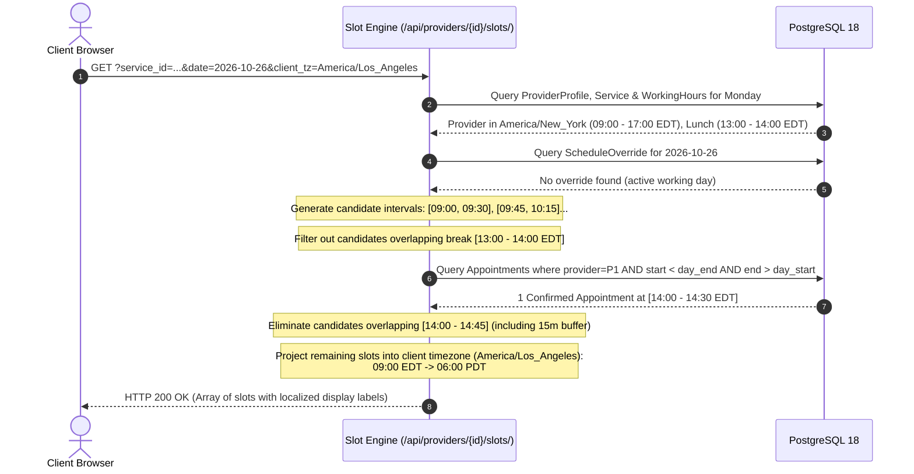
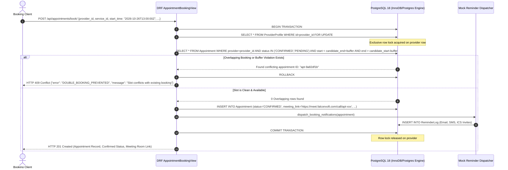
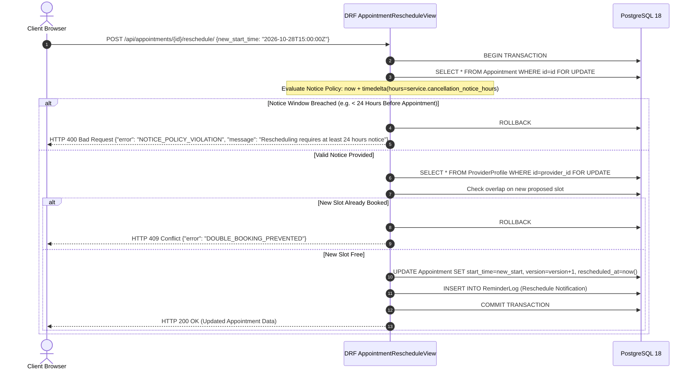

# Falcon Calendar — API Workflows & Sequence Flows
**Deliverable 04 | FalconXoft 15-Day Intern Performance Evaluation | Project 2**

---

## 1. Lucidchart Workspace Reference
> **Lucidchart Editable API Flows URL:**  
> [https://lucid.app/lucidchart/e9fd80d5-1509-4b3b-8e8d-6f349d603ca2/edit?viewport_loc=74%2C-84%2C3316%2C1609%2C0_0&invitationId=inv_b4b4df8d-4a77-4a75-81b6-1d81dca18a9f](https://lucid.app/lucidchart/e9fd80d5-1509-4b3b-8e8d-6f349d603ca2/edit?viewport_loc=74%2C-84%2C3316%2C1609%2C0_0&invitationId=inv_b4b4df8d-4a77-4a75-81b6-1d81dca18a9f)  
> *Note: Complete sequence flows covering success paths, conflict handling, and failure states.*  
> **Exported Deliverable Files:** [`04 - api-workflows.png`](./04%20-%20api-workflows.png) | [`04 - api-workflows.pdf`](./04%20-%20api-workflows.pdf) | [`04 - openapi.yaml`](./04%20-%20openapi.yaml)

---

## 2. API Specifications & Interactive Documentation
- **OpenAPI 3.0 YAML Specification:** Located at [04 - openapi.yaml](file:///d:/week_2/02_Scheduling_SaaS/04%20-%20openapi.yaml)
- **Live Swagger UI:** `http://127.0.0.1:8001/api/docs/`
- **Live Redoc View:** `http://127.0.0.1:8001/api/redoc/`

---

## 3. Sequence Flow: Dynamic Slot Generation & Timezone Projection

---

## 4. Sequence Flow: Atomic Booking & Double-Booking Prevention

---

## 5. Sequence Flow: Rescheduling with Advance Notice Policy Check

---

## 6. Comprehensive Endpoint Reference

| Method | Endpoint | Query / Body Payload | Response Codes | Description |
| :--- | :--- | :--- | :--- | :--- |
| **GET** | `/api/providers/` | None | `200 OK` | Retrieves all active consultants with embedded services and working hours |
| **GET** | `/api/providers/{id}/` | None | `200 OK`, `404 Not Found` | Retrieves individual consultant detail |
| **GET** | `/api/providers/{id}/slots/` | `service_id`, `date`, `client_tz` | `200 OK`, `400 Bad Request` | Generates available slots projected into client timezone |
| **POST** | `/api/appointments/book/` | `provider_id`, `service_id`, `start_time`, `customer_name`, `customer_email`, `customer_phone`, `customer_notes` | `201 Created`, `400 Bad Request`, `409 Conflict` | Atomically secures slot with pessimistic locking |
| **POST** | `/api/appointments/{id}/reschedule/` | `new_start_time`, `customer_timezone` | `200 OK`, `400 Bad Request`, `409 Conflict` | Reschedules session subject to notice policy |
| **POST** | `/api/appointments/{id}/cancel/` | `reason` | `200 OK`, `400 Bad Request` | Cancels session and dispatches cancellation alerts |
| **GET** | `/api/appointments/` | `email`, `provider_id`, `status` | `200 OK` | Filtered appointment query for portal and administration |
| **GET** | `/api/reminders/` | `appointment_id`, `channel` | `200 OK` | Audit trail of dispatched multi-channel reminders |
| **GET** | `/api/dashboard/metrics/` | None | `200 OK` | Real-time business intelligence: gross revenue, confirmed, upcoming, completed |
