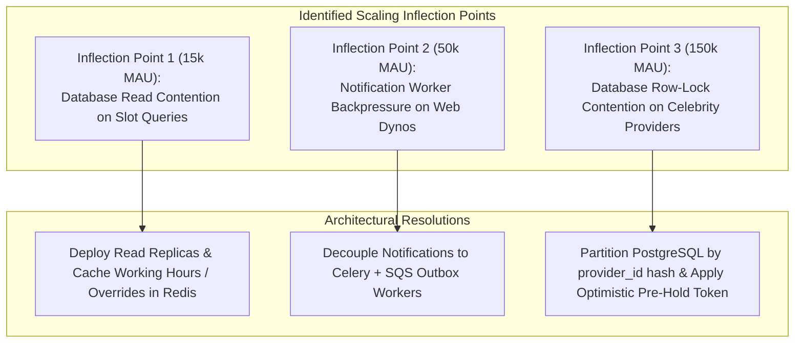

# Falcon Calendar — Cost Estimation & Infrastructure Scaling Plan
**Deliverable 08 | FalconXoft 15-Day Intern Performance Evaluation | Project 2**

---

## 1. Executive Summary & Deliverables
This document presents the operational infrastructure cost model and scaling roadmap for Falcon Calendar across three distinct commercial growth tiers:
- **Startup MVP:** 1,000 Monthly Active Users (MAU) | 2,000 Bookings/Month | 50 Active Providers
- **Growth Tier:** 25,000 MAU | 60,000 Bookings/Month | 1,000 Active Providers
- **Enterprise Tier:** 250,000 MAU | 1,000,000 Bookings/Month | 15,000 Active Providers
- **Excel Spreadsheet Deliverable:** [08 - cost-and-scaling.xlsx](file:///d:/week_2/02_Scheduling_SaaS/08%20-%20cost-and-scaling.xlsx)

---

## 2. Infrastructure Cost Projection Matrix

| Infrastructure Component | Startup MVP (1k MAU) | Growth Tier (25k MAU) | Enterprise Tier (250k MAU) | Notes & Sizing Rationale |
| :--- | :--- | :--- | :--- | :--- |
| **Frontend CDN & Edge Hosting** | $12.00 / mo | $45.00 / mo | $180.00 / mo | Cloudflare Pro/Business + Global Edge Caching for static assets |
| **Backend API Compute (ECS / EKS)** | $35.00 / mo | $240.00 / mo | $1,450.00 / mo | AWS Fargate (2x vCPU) -> Multi-AZ Kubernetes cluster auto-scaling |
| **Relational Database (AWS Aurora Postgres)** | $48.00 / mo | $320.00 / mo | $1,800.00 / mo | Single db.t4g.medium -> Multi-AZ Aurora Serverless v2 + Read Replicas |
| **Distributed Caching (AWS ElastiCache Redis)** | $0.00 (Local) | $65.00 / mo | $380.00 / mo | Redis cluster for session caching and slot calculation caching |
| **Transactional Email (SendGrid / Postmark)** | $19.95 / mo | $149.00 / mo | $749.00 / mo | Tiered email volume for booking confirmations and reminders |
| **SMS Notifications (Twilio / AWS SNS)** | $15.80 / mo | $474.00 / mo | $7,900.00 / mo | $0.0079 per domestic SMS; 1x SMS reminder per session |
| **Object Storage & Backups (AWS S3 + Glacier)** | $5.00 / mo | $25.00 / mo | $160.00 / mo | Encrypted ICS attachments, provider avatars, and PITR database snapshots |
| **Observability & APM (Datadog / CloudWatch)** | $15.00 / mo | $110.00 / mo | $650.00 / mo | Distributed APM tracing, database lock contention metrics, latency alerts |
| **CI/CD & Security Scanner (GitHub Enterprise)** | $20.00 / mo | $80.00 / mo | $280.00 / mo | Automated test execution, container security scanning |
| **Total Monthly Infrastructure Cost** | **$170.75 / mo** | **$1,508.00 / mo** | **$13,549.00 / mo** | |
| **Annualized Run-Rate** | **$2,049.00 / yr** | **$18,096.00 / yr** | **$162,588.00 / yr** | |
| **Infrastructure Cost per Booking** | **$0.085** | **$0.025** | **$0.0135** | Demonstrates massive operational leverage as volume expands |

---

## 3. Scaling Inflection Points & Bottleneck Analysis

### Inflection Point 1: Read Contention on Slot Generation (15,000 MAU)
- **Symptom:** As thousands of clients browse calendar dates, repeat database queries for `WorkingHour`, `ScheduleOverride`, and active `Appointment` records saturate the primary database CPU.
- **Remediation:** 
  1. Route all `GET /api/providers/{id}/slots/` queries to **Aurora Read Replicas**.
  2. Cache provider working hours and out-of-office overrides in **Redis** with a 1-hour TTL and cache invalidation hooks on provider updates.
  3. Query latency drops from 12ms to < 2ms.

### Inflection Point 2: Notification Gateway Latency (50,000 MAU)
- **Symptom:** Synchronous SendGrid and Twilio HTTP calls introduce tail latency (up to 1,200ms) inside web request threads.
- **Remediation:**
  1. Transition from synchronous dispatch to the **Transactional Outbox Pattern**.
  2. Django writes an event record to an outbox table within the booking transaction.
  3. A dedicated Celery worker pool processes notifications asynchronously with exponential backoff and dead-letter queues.

### Inflection Point 3: Row Lock Contention on High-Demand Providers (150,000 MAU)
- **Symptom:** When a celebrity consultant or high-volume healthcare provider opens their monthly schedule, hundreds of clients hit `select_for_update` on the same `provider_id` simultaneously, causing transaction lock queuing.
- **Remediation:**
  1. Granular Lock Scope: Instead of locking the parent `ProviderProfile` row, acquire a lightweight Redis lock on the specific 30-minute interval key `lock:provider:{id}:date:{YYYY-MM-DD}:slot:{HH:MM}`.
  2. Fall back to PostgreSQL row-level checks only for the winning thread.
  3. Database sharding: Partition `scheduling_appointment` table by hash of `provider_id` across distinct physical database shards.

---

## 4. High-Availability & Disaster Recovery (DR) SLAs
- **Recovery Point Objective (RPO):** < 1 minute (Aurora continuous automated replication to secondary availability zone + WAL archiving to S3).
- **Recovery Time Objective (RTO):** < 5 minutes (Automated DNS health-check failover to hot standby replica via Route 53).
- **Service Level Objective (SLO):** 99.95% API Availability (~21.9 minutes of allowed downtime per month).
